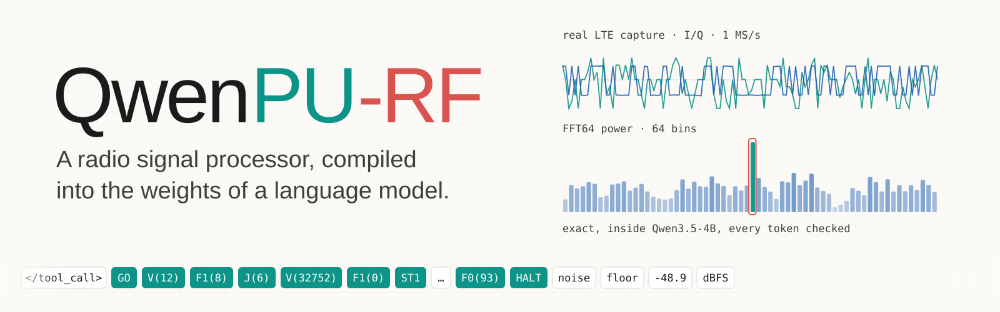
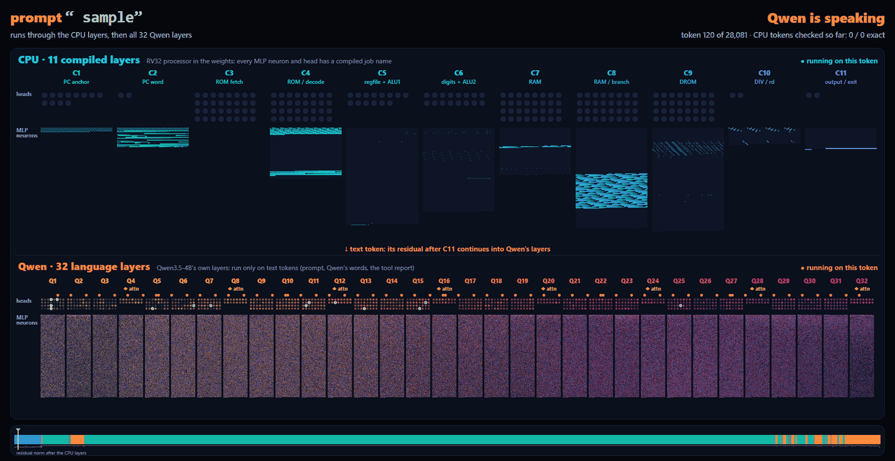
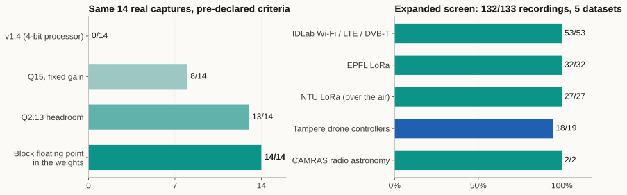
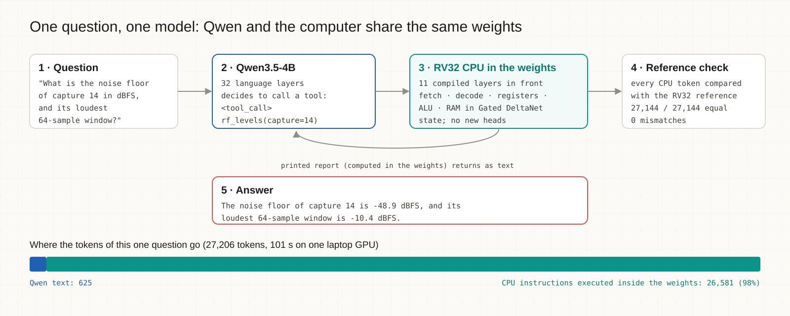
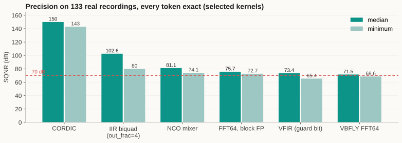
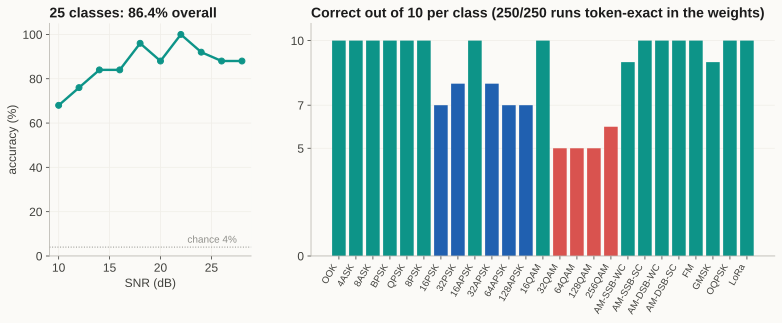

<p align="center">
  
</p>

<p align="center">
  <a href="#quickstart"></a>
  <a href="#results"></a>
  <a href="#results"></a>
  <a href="LICENSE"></a>
  
</p>

Built on [QwenPU](https://github.com/divagr18/QwenPU) and part of the
[Qwenputer](https://github.com/divagr18/qwenputer) family of computers compiled into Qwen3.5's weights.
Model weights: Hugging Face upload in progress.

**QwenPU-RF is Qwen3.5-4B doing exact radio signal processing inside its own weights.** FIR filters,
FFTs, CORDIC, detectors, demodulators and a 25-class modulation classifier run as RISC-V programs on
the CPU that QwenPU compiles into the model's layers. In the middle of a conversation Qwen calls that
processor with an ordinary `<tool_call>`. The program then runs as trace tokens through the model's
own forward passes, every one of them checked against a reference RISC-V machine, and Qwen answers
from the report the program prints. No Python tool, no host arithmetic: the host only copies words in
and out.

<p align="center">
  
</p>
<p align="center"><sub>
A real run, recorded neuron by neuron (<a href="v15/viz/">v15/viz</a>). Asked for the noise floor of a capture, Qwen emits
<code>rf_levels(capture=14)</code>. The next 26,581 tokens are CPU instructions running through the 11 compiled layers (top);
Qwen's 32 layers (bottom) sit idle until the printed report comes back. Every CPU token equals the RV32 reference:
27,144 / 27,144. Answer: −48.9 dBFS noise floor, −10.4 dBFS loudest window.
</sub></p>

## Results

Measured on one RTX 5090 laptop GPU. Every gate was declared before its run in
[PROTOCOL.md](v15/research/PROTOCOL.md), and failures stay in the record.

| | Result |
|---|---|
| **Real IQ, 14 pre-selected captures** | v1.4's 4-bit design **0/14** → Q15 **8/14** → headroom **13/14** → block floating point computed in the weights **14/14** |
| **Expanded screen, 5 datasets** | **132/133** recordings pass (IDLab Wi-Fi/LTE/DVB-T, EPFL and NTU LoRa, Tampere drones, CAMRAS radio astronomy); the one miss is a 0.024% matched-filter near-tie |
| **Full 8-stage pipeline** | **133/133** streams, every stage token-exact, 288.6 M tokens |
| **10-kernel battery** | 10 kernels × 133 recordings exact; FFT64 75.7 dB, CORDIC 150 dB, NCO 81.1 dB median SQNR |
| **Qwen calls its own RF tools** | 96-question bank: **96/96** circuit-exact, right tool 96/96, 99.0% of numbers in answers traceable to the verified report |
| **Unanswerable questions** | declined **16/16** after the `not_measured` fix (was 4/8: exact numbers do not make conclusions exact) |
| **25-class blind modulation classifier in the weights** | **86.4%** (chance 4%), 250/250 runs token-exact; Qwen calls `rf_modulation` and names the printed class 10/10 |
| **New RF vector instructions** | VFIR **6.73×** faster than scalar (95% CI 6.727–6.738), VPOW, VBFLY (FFT butterfly) **1.8×**, all token-exact on saved checkpoint weights |
| **Tests** | 218 CPU-reference tests pass (+21 for the RF branch) |

<p align="center"></p>

Full tables, timings and every caveat: [v15/README.md](v15/README.md) · ledger [v15/results.md](v15/results.md) ·
gates [v15/reports/gates.json](v15/reports/gates.json) · lab notes [RESEARCH_LOG.md](v15/research/RESEARCH_LOG.md).

## How it works

<p align="center"></p>

1. **The computer.** [QwenPU](https://github.com/divagr18/QwenPU) compiles an RV32 CPU (and a vector unit)
   into Qwen3.5-4B: 11 extra layers in front of Qwen's own, with RAM held in Gated DeltaNet state. A
   compiler sets every new weight; nothing is trained.
2. **The RF programs.** Each kernel in [v15/rfpu_v15/cpu/](v15/rfpu_v15/cpu) is an RV32 program generator
   paired with an independent integer reference. Arithmetic is Q15 with exact 32/64-bit accumulation,
   block floating point where the dynamic range needs it, and no data-dependent branches.
3. **The tools.** [firmware.py](v15/rfpu_v15/stage2/firmware.py) builds `rf_analyze`, `rf_levels` and
   `rf_modulation`. Qwen's tool call is written into the machine's RAM, the program runs and prints its
   report, and the report is fed back to Qwen as the tool response.
4. **The check.** A token counts only if the model's own prediction equals the RV32 reference trace, and
   an output counts only if it equals the independent integer reference. CPU-only results are never
   reported as neural.

<details>
<summary><b>What runs in the weights</b>: every kernel neural-exact, measured on real IQ</summary>

| Group | Kernels |
|---|---|
| Filtering | complex FIR 4–64 taps, windowed-sinc lowpass, decimating FIR, IIR biquad, DC blocker |
| Frequency | NCO mixer (Taylor-interpolated, 85.8 dB) |
| Spectral | FFT 4–256 power, FFT64 complex bins, block-floating-point FFT, Welch PSD, single-bin DFT |
| Detection | CA-CFAR, energy detector with noise floor and burst edges, peak search |
| Demodulation | CORDIC magnitude and phase, AM envelope, FM discriminator, CFO estimate |
| Inference | spectral MLP, 3-class technology classifier (96.2% per recording at 10 MS/s), 30-feature + 30-32-25 integer MLP modulation classifier |
| Vector unit | VX energy, VX MLP, VFIR, VXFFT64 on VBFLY |

Tokens and milliseconds per sample for each: [v15/README.md#capability-matrix](v15/README.md#capability-matrix).
</details>

<p align="center"></p>
<p align="center"></p>

## Limits

- **Slow:** about 10⁵–10⁶× slower than a conventional DSP. No real-time claim is made.
- **Numbers, not conclusions:** the answers' numbers are verified; Qwen's interpretation is checked by an
  automatic answer checker, not proven. Two held-out gates failed before the `not_measured` fix, and two
  still fail strictly after it (Amendments 13–14).
- **Modulation classifier:** synthetic signals from our own generator (known samples per symbol, no CFO
  or multipath). 86.4% is in-distribution; high-order QAM is the weak spot.
- **Executor vs saved layers:** the large campaigns ran on QwenPU's fused executor (the same circuit).
  Agreement with the saved checkpoint layers was checked on representative programs and on every Stage 2
  full-GPU run.
- **Pre-declared failures stay failures:** VFIR precision 69.2 dB (< 70, P6.3) and 68.3 dB on attenuated
  outputs (P12.6); the per-tap rounding in the instruction contract is the cause.

All of them, with numbers: [v15/README.md#limitations](v15/README.md#limitations).

## Quickstart

Three levels, from no GPU to the full model.

```bash
git clone https://github.com/pratx1906/QWENPU-RF && cd QWENPU-RF
python upstream/setup_upstream.py              # QwenPU at 5af1fc0 + the RF instruction patch
python -m venv .venv && . .venv/bin/activate   # Windows: .venv\Scripts\activate
pip install -e "upstream/QwenPU[hf]" -r requirements.txt
```

**1. Check the logic (CPU, about 2 minutes, no downloads).** Every kernel against its independent integer reference:

```bash
python -m pytest v15/tests -q -p no:cacheprovider          # 218 passed, 21 skipped
PYTHONPATH=upstream/QwenPU-rf python -m pytest v15/tests/test_vfir.py -q   # the RF instructions
```

**2. Run the RF programs in the weights (24 GB GPU).** The pipeline on synthetic signals with known
ground truth, every token checked:

```bash
python v15/scripts/pipeline_run.py --synthetic             # PASS / FAIL
python v15/scripts/modulation_demo.py neural               # 25-class classifier, 250 captures
```

**3. Ask Qwen (24 GB GPU, the 19 GB merged checkpoint).** Build it from the base model, or download it
once the Hugging Face upload is up:

```bash
python -m chipformer.rv.merge $RFPU_DATA/checkpoints/qwen3.5-4b --out $RFPU_DATA/checkpoints/rfpu-v15/qwen3.5-4b-rv1
python v15/scripts/stage2_chat.py --suite robust --full-gpu $RFPU_DATA/checkpoints/rfpu-v15/qwen3.5-4b-rv1 --chunk 1024
python v15/viz/record.py && python v15/viz/serve.py $RFPU_DATA/viz/levels-q0   # the visualizer above
```

Real-recording experiments need the public datasets: [data/README.md](data/README.md). Every result,
with its script, runtime and evidence file: [v15/REPRODUCE.md](v15/REPRODUCE.md).

## Repository

| Path | What it is |
|---|---|
| [v15/rfpu_v15/cpu/](v15/rfpu_v15/cpu) | RF kernels: RV32 program generators plus independent integer references |
| [v15/rfpu_v15/stage2/](v15/rfpu_v15/stage2) | The in-weights tools Qwen calls, and chunked verification |
| [v15/scripts/](v15/scripts) | Every experiment; `run.py` is the append-only ledger |
| [v15/reports/](v15/reports) | Evidence: one JSON per experiment, `gates.json`, Stage 2 transcripts |
| [v15/research/](v15/research) | Design, pre-declared protocol with 15 amendments, lab notes |
| [v15/viz/](v15/viz) | The neuron-level visualizer used for the GIF (add `&poster` to the URL for this look) |
| [v15/paper/](v15/paper) | Paper draft |
| [upstream/](upstream) | QwenPU pin and `rfpu-vx.patch` (VFIR, VPOW, VBFLY) |
| [data/](data) | Capture selections, dataset manifests with SHA-256, the list of large files |
| [docs/](docs) | Figures, regenerated by `docs/make_figures.py` from the evidence |

## How it got here

v1.0 ran Q7/Q15 programs on QwenPU's published checkpoint. v1.1–v1.4 built custom 4-bit neural
processors; v1.4 failed every real capture (0/14), and the
[failure analysis](v15/research/NUMERICAL_FAILURE_ANALYSIS.md) traced it to 4-bit intermediate narrowing.
v1.5, this repository, moved all signal arithmetic onto QwenPU's own CPU at 16 bits and added the
pre-declared protocol. The earlier versions are summarised in the lab notes and not included here.

## Citing

See [CITATION.cff](CITATION.cff). Please also cite [QwenPU](https://github.com/divagr18/QwenPU) and
[Qwenputer](https://github.com/divagr18/qwenputer), which this work is built on.

## License and data

Code: [MIT](LICENSE). The patch in `upstream/` modifies QwenPU (MIT, © Divyansh Agrawal). Model weights
derive from [Qwen/Qwen3.5-4B](https://huggingface.co/Qwen/Qwen3.5-4B) (Apache-2.0). The datasets are not
redistributed; each keeps its own licence ([data/README.md](data/README.md)). Thanks to IDLab (Ghent
University – imec), EPFL TCL, NTU, Tampere University and CAMRAS for publishing their recordings.
